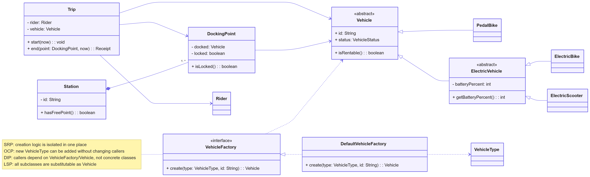

# Factory Method — Vehicle Creation (Reviewed Implementation)

## Problem
Creating a `PedalBike`, `ElectricBike`, or `ElectricScooter` at each point of use ties client code to all three concrete classes. The design should preserve the common `Vehicle` API and isolate product construction so that trip workflows work regardless of vehicle type.

## Solution and justification
`VehicleCreator` is the abstract **Creator**. It defines a public `create(id)` method that validates inputs and delegates construction to the protected **factory method** `createVehicle(id)`. `PedalBikeCreator`, `ElectricBikeCreator`, and `ElectricScooterCreator` override the factory method to return a concrete `Vehicle` product. `VehicleFactoryImpl` implements the existing `VehicleFactory` interface and selects an appropriate creator from a registry keyed by `VehicleType`. Callers continue to use `VehicleFactory.create(type, id)` and receive a `Vehicle`, so the rest of the GoCycle code does not depend on specific constructors.

## Small UML snippet

## Benefits and trade-offs
The concrete construction rules are now local to the corresponding creator subclass and can be individually tested. `Main` uses the factory instead of `new PedalBike(...)`. Unlike the earlier switch-only implementation (which was closer to a *Simple Factory*), the polymorphic `createVehicle` method clearly implements Factory Method. The design adds creator classes and a small selection registry; adding a new `VehicleType` still requires wiring that type into the registry. This is a deliberate compromise to preserve the team's original `VehicleFactory` API.
