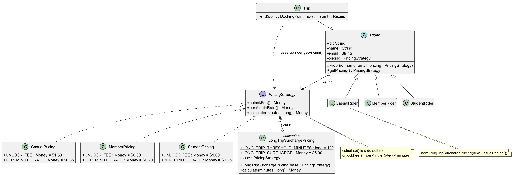
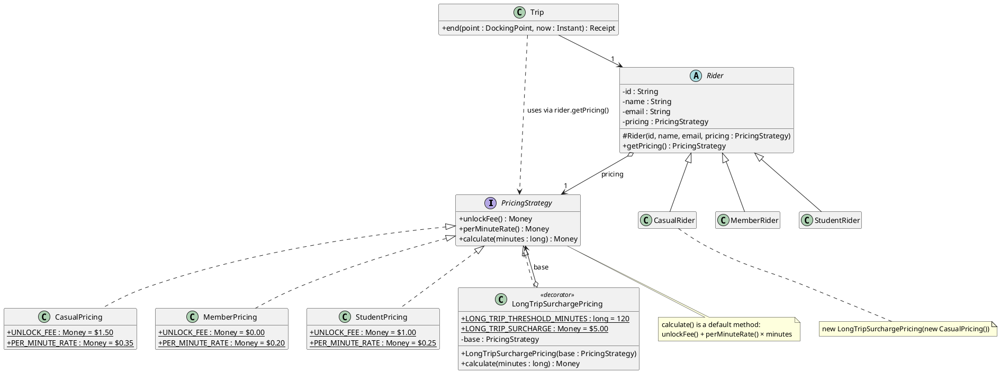

# Design Pattern: Strategy (Rider Pricing)

## Problem

GoCycle charges each rider type differently:

| Rider type | Unlock fee | Per minute |
|------------|-----------|------------|
| Casual | $1.50 | $0.35 |
| Member | $0.00 | $0.20 |
| Student | $1.00 | $0.25 |

Every type also pays a $5.00 surcharge on trips longer than 2 hours (FR-03 to FR-07). The client has said new rider types will be added later and that pricing must be easy to extend (QR-01). The design therefore has to let a new way of pricing be added without editing the code that already calculates prices or runs trips.

## Why Strategy

The **Strategy** pattern puts each pricing rule in its own class behind a common interface, `PricingStrategy`. A `Rider` holds one strategy, passed in through its constructor, and `Trip` asks the rider's strategy for the cost without knowing which one it is.

We considered two alternatives:

- **An if/else or switch on the rider type** (e.g. in `Trip`):
  - Every new rider type means editing that conditional, and any others that copy it, which breaks the Open/Closed Principle and QR-01.
  - The pricing rules would be mixed into trip logic, so `Trip` would have more than one reason to change.
  - The rules could only be tested by running whole trips.
- **Subclasses overriding a pricing method** (e.g. `CasualRider.calculateCost()`):
  - This avoids the conditional, but ties pricing to the rider class hierarchy. A rider's pricing could not change, for example during a promotion, without changing their class, and two rider types could not share a pricing rule.
  - A rule that applies to everyone, like the long-trip surcharge, would have to be repeated in every subclass or forced into a shared base class.
  - `Rider` would then be responsible for both who the rider is and how they are charged.

With Strategy, `Rider` knows only *which* pricing applies, each `PricingStrategy` knows only *how* to price, and `Trip` depends only on the `PricingStrategy` interface.

## Class diagram

Each rider subclass passes its strategy to `Rider`'s constructor, already wrapped in the surcharge decorator. For example, `CasualRider` passes `new LongTripSurchargePricing(new CasualPricing())`. The code is in `src/main/java/gocycle/pricing/` and `src/main/java/gocycle/rider/`.
