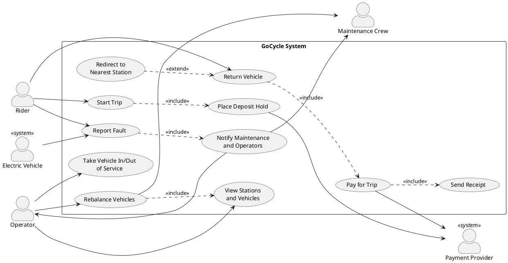

# GoCycle Use Case Model

This document describes who uses GoCycle and the main ways they use it. Requirement IDs (FR, QR, C) refer to [requirements.md](requirements.md).

## Actors

| Actor | Kind | Description |
|-------|------|-------------|
| Rider | Primary, human | A casual rider, member or student who rents vehicles through the phone app or a station screen. |
| Operator | Primary, human | Control-room staff who monitor all stations and vehicles, rebalance vehicles and take vehicles in or out of service. |
| Maintenance Crew | Secondary, human | Field staff who are notified of faults, repair vehicles and physically move vehicles during rebalancing. |
| Electric Vehicle | Primary, system | An e-bike or e-scooter that reports its own low battery and faults to GoCycle. |
| Payment Provider | Secondary, system | The external service behind credit cards, city transit cards and phone wallets; it places holds and processes charges. |

## Use case diagram

The diagram shows these relationships:

- **Start Trip** always includes **Place Deposit Hold**.
- **Return Vehicle** always includes **Pay for Trip**, which always includes **Send Receipt**.
- **Report Fault** always includes **Notify Maintenance and Operators**, whether the rider or the electric vehicle raises the report.
- **Redirect to Nearest Station** extends **Return Vehicle** only when the station has no free docking point.

## UC-01 Start Trip

| | |
|-|-|
| **ID** | UC-01 |
| **Primary actor** | Rider |
| **Secondary actors** | Payment Provider |
| **Stakeholders and interests** | **Rider:** wants to unlock a working vehicle quickly and be charged fairly. **GoCycle:** wants only safe, charged vehicles rented and a deposit secured before the vehicle leaves. **Payment Provider:** wants a valid hold request on an accepted method. |
| **Preconditions** | The rider has an account with a rider type (casual, member or student) and at least one payment method. The rider is at a station with at least one docked vehicle. |

**Main success scenario**

1. The rider identifies themselves through the phone app or by tapping their card on the station's card reader.
2. The rider selects a docked vehicle.
3. The system checks that the vehicle is rentable: it is in service, and if it is electric, its battery is at least 20%.
4. The rider chooses a payment method.
5. The system checks that the payment method is allowed in the station's zone.
6. The system places a refundable $50.00 deposit hold through the Payment Provider (include **Place Deposit Hold**).
7. The system unlocks the vehicle, marks it in use and records the start time.
8. The rider takes the vehicle, and the trip is active.

**Alternate flows**

- **1a. The card reader cannot read the rider's card:**
  1. The station screen asks the rider to tap again or use the phone app.
  2. The use case resumes at step 1.
- **3a. The electric vehicle's battery is below 20%:**
  1. The system tells the rider the vehicle cannot be rented because its battery is low, and shows other vehicles at the station.
  2. If the rider picks another vehicle, the use case resumes at step 2. Otherwise it ends and no trip starts.
- **3b. The vehicle is out of service:**
  1. The system tells the rider the vehicle is unavailable.
  2. The use case continues as in 3a.
- **5a. The payment method is not allowed in this zone:**
  1. The system tells the rider the method is not accepted here and lists the methods this zone allows.
  2. If the rider chooses an allowed method, the use case resumes at step 5. Otherwise it ends and no trip starts.
- **6a. The Payment Provider declines the deposit hold:**
  1. The system tells the rider the hold was declined. The vehicle stays locked.
  2. If the rider chooses another method, the use case resumes at step 4. Otherwise it ends and no trip starts.
- **7a. The vehicle fails to unlock:**
  1. The system releases the deposit hold and leaves the trip not started.
  2. The rider is invited to report a fault (UC-03) and choose another vehicle.

**Postconditions**

- **Success:** a trip is active for the rider, the deposit hold is placed, the vehicle is marked in use and the start time is recorded.
- **Failure:** no trip exists, no hold remains on the rider's payment method and the vehicle stays docked.

**Related requirements:** FR-01, FR-02, FR-08, FR-11, FR-12, FR-22, FR-23, FR-24, FR-25, C-01, C-03, QR-04

## UC-02 Return Vehicle

| | |
|-|-|
| **ID** | UC-02 |
| **Primary actor** | Rider |
| **Secondary actors** | Payment Provider |
| **Stakeholders and interests** | **Rider:** wants to be able to return anywhere convenient and to stop paying as soon as the vehicle is docked. **GoCycle:** wants every vehicle securely locked before a trip ends, so vehicles are not lost. **Operators:** want accurate station occupancy. |
| **Preconditions** | The rider has an active trip (UC-01). |

**Main success scenario**

1. The rider arrives at a station.
2. The system shows that the station has a free docking point.
3. The rider pushes the vehicle into the free docking point.
4. The docking point confirms the vehicle is locked.
5. The system records the end time and ends the trip; charging stops at this moment.
6. The system takes payment (include **Pay for Trip**, UC-04).
7. The system marks the vehicle available at this station.

**Alternate flows**

- **2a. The station has no free docking point (extend Redirect to Nearest Station):**
  1. The system finds the nearest station with at least one free docking point and directs the rider there on the station screen or in the app.
  2. The trip stays active and charging continues.
  3. The use case resumes at step 1 at the new station.
- **4a. The docking point does not confirm the lock:**
  1. The system tells the rider the vehicle is not locked and asks them to re-seat it.
  2. The trip stays active and charging continues.
  3. The use case resumes at step 3.
  4. If the lock still fails, the rider may report a fault on the docking point or vehicle (UC-03) and use another free point.
- **6a. Payment fails:** see UC-04, alternate flows 3a and 3b.

**Postconditions**

- **Success:** the vehicle is locked in a docking point and marked available, the trip has ended with its end time equal to the lock-confirmation time, and the rider has paid and received a receipt.
- **While not locked:** the trip remains active and charging continues.

**Related requirements:** FR-13, FR-14, FR-15, FR-16, FR-17, FR-09, FR-30, QR-03, C-02

## UC-03 Report Fault

| | |
|-|-|
| **ID** | UC-03 |
| **Primary actor** | Rider, or Electric Vehicle when the report is self-generated |
| **Secondary actors** | Maintenance Crew, Operator |
| **Stakeholders and interests** | **Rider:** wants to report a problem quickly and not be charged for a broken vehicle. **Other riders:** want broken vehicles removed so they are not rented. **Maintenance Crew:** wants clear details of the fault and the vehicle. **Operators:** want to know which vehicles are unavailable. |
| **Preconditions** | The vehicle is registered in GoCycle. |

**Main success scenario**

1. The rider chooses **Report Fault** in the app or on the station screen.
2. The rider identifies the vehicle, e.g. by scanning its code or selecting it at the station.
3. The rider chooses the fault type (flat tire, broken brakes or other) and may add a description.
4. The system records the fault report.
5. The system takes the vehicle out of service so it cannot be rented.
6. The system notifies the maintenance crew and the control-room operators (include **Notify Maintenance and Operators**).
7. The system confirms to the rider that the fault has been reported.

**Alternate flows**

- **1a. The fault is self-reported by an electric vehicle:**
  1. The vehicle detects low battery or an electrical fault and sends a report with its fault type.
  2. The use case continues at step 4, and step 7 is skipped because there is no rider to confirm to.
- **2a. The rider reports a fault on the vehicle they are currently riding:**
  1. The system records the report and asks the rider to return the vehicle to the nearest station (UC-02).
  2. The system immediately marks the vehicle OUT_OF_SERVICE and notifies the maintenance crew and operators. The trip remains active until the vehicle is securely docked; returning it must not restore AVAILABLE status.
- **5a. The vehicle is already out of service:**
  1. The system adds the report to the vehicle's existing fault record.
  2. The crew and operators are notified of the additional report, and the use case continues at step 7.

**Postconditions**

- The fault is recorded, the vehicle is out of service and cannot be rented, and the maintenance crew and operators have been notified.

**Related requirements:** FR-18, FR-19, FR-20, FR-21, QR-04

## UC-04 Pay for Trip

| | |
|-|-|
| **ID** | UC-04 |
| **Primary actor** | Rider |
| **Secondary actors** | Payment Provider |
| **Stakeholders and interests** | **Rider:** wants to be charged the correct amount, exactly once, and to get the deposit back. **GoCycle:** wants to collect the full fare. **Payment Provider:** wants valid charge and release requests. |
| **Preconditions** | The trip has ended with the vehicle confirmed locked (UC-02, step 5). A deposit hold is in place. This use case is included by UC-02. |

**Main success scenario**

1. The system calculates the billed minutes from the start and end times, rounding any partial minute up.
2. The system calculates the cost using the rider type's pricing: the unlock fee plus the per-minute rate times the billed minutes, plus the long-trip surcharge if the trip was longer than 120 minutes.
3. The system charges the cost to the rider's payment method through the Payment Provider.
4. The system releases the deposit hold.
5. The system creates a receipt showing the trip, vehicle, times, minutes, unlock fee, time charge, any surcharge and the total.
6. The system sends the receipt through the app or by email (include **Send Receipt**).

**Alternate flows**

- **3a. The Payment Provider declines the charge:**
  1. The system keeps the deposit hold in place and tells the rider the payment was declined.
  2. The system asks for another payment method allowed in the zone.
  3. If the rider provides one, the use case resumes at step 3.
- **3b. The rider has no other payment method:**
  1. The amount stays outstanding and is flagged to the control room, and the deposit hold is kept.
  2. The use case ends without a receipt.
- **3c. The chosen replacement method is not allowed in the zone:**
  1. The system lists the zone's allowed methods.
  2. The use case resumes at 3a, step 2.
- **6a. Email delivery fails:**
  1. The system shows the receipt in the app instead.
  2. The system retries the email later.

**Postconditions**

- **Success:** the rider has been charged the calculated cost exactly once, the deposit hold is released and the rider has a receipt.
- **Charge declined:** the deposit hold remains, and no receipt is issued.

**Related requirements:** FR-03, FR-04, FR-05, FR-06, FR-07, FR-09, FR-22, FR-23, FR-30, FR-31, QR-02, C-03

## UC-05 Rebalance Vehicles

| | |
|-|-|
| **ID** | UC-05 |
| **Primary actor** | Operator |
| **Secondary actors** | Maintenance Crew |
| **Stakeholders and interests** | **Riders:** want vehicles at the stations where they start trips and free points where they end them. **Operators:** want an accurate picture of vehicle locations. **Maintenance Crew:** want clear instructions on what to move and where. |
| **Preconditions** | The operator is logged in to the control-room view. |

**Main success scenario**

1. The operator opens the view of all stations and vehicles (include **View Stations and Vehicles**).
2. The system shows each station's docked vehicles, free docking points and each vehicle's status and battery level.
3. The operator identifies a station with too many vehicles and a station with too few.
4. The operator selects the vehicles to move and the destination station.
5. The system marks the selected vehicles unavailable for rent and unlocks them for the crew.
6. The maintenance crew moves the vehicles and docks them at the destination station.
7. Each destination docking point confirms its vehicle is locked, and the system marks the vehicle available at its new station.
8. The system updates the view.

**Alternate flows**

- **4a. The destination station does not have enough free docking points:**
  1. The system warns the operator and shows how many points are free.
  2. The operator either moves fewer vehicles or chooses another destination, and the use case resumes at step 4.
- **5a. A selected vehicle is rented before it is unlocked for the crew:**
  1. The system removes it from the move and tells the operator.
  2. The use case continues with the remaining vehicles.
- **6a. The crew finds a vehicle is faulty during the move:**
  1. The crew reports the fault (UC-03), and the vehicle is taken out of service instead of being docked as available.
- **7a. A destination docking point does not confirm the lock:**
  1. The vehicle stays unavailable and the operator is alerted.
  2. The crew re-docks it, and the use case resumes at step 7.

**Postconditions**

- The moved vehicles are locked at the destination station and available to rent, and the operator's view shows the new distribution.

**Related requirements:** FR-27, FR-28, FR-29, FR-15, C-02
