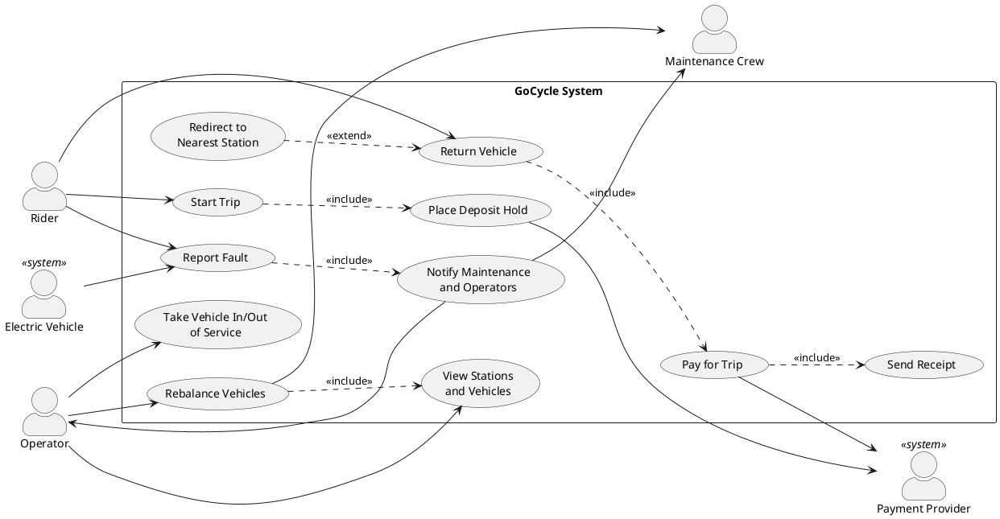

# GoCycle Use Case Model

This document describes who uses GoCycle and the main ways they use it. Requirement IDs (FR, QR, C) refer to [requirements.md](requirements.md).

## Actors

| Actor | Kind | Description |
|-------|------|-------------|
| Rider | Primary, human | A casual rider, member or student who rents vehicles through the phone app or a station screen. |
| Operator | Primary, human | Control-room staff who monitor all stations and vehicles, rebalance vehicles and take vehicles in or out of service. |
| Maintenance Crew | Secondary, human | Field staff who are notified of faults, repair vehicles and physically move vehicles during rebalancing. |
| Electric Vehicle | Primary, system | An e-bike or e-scooter that reports its own low battery and faults to GoCycle. |
| Payment Provider | Secondary, system | The external service behind credit cards, city transit cards and phone wallets; it places holds and processes charges. |

## Use case diagram

The diagram shows these relationships:

- **Start Trip** always includes **Place Deposit Hold**.
- **Return Vehicle** always includes **Pay for Trip**, which always includes **Send Receipt**.
- **Report Fault** always includes **Notify Maintenance and Operators**, whether the rider or the electric vehicle raises the report.
- **Redirect to Nearest Station** extends **Return Vehicle** only when the station has no free docking point.
