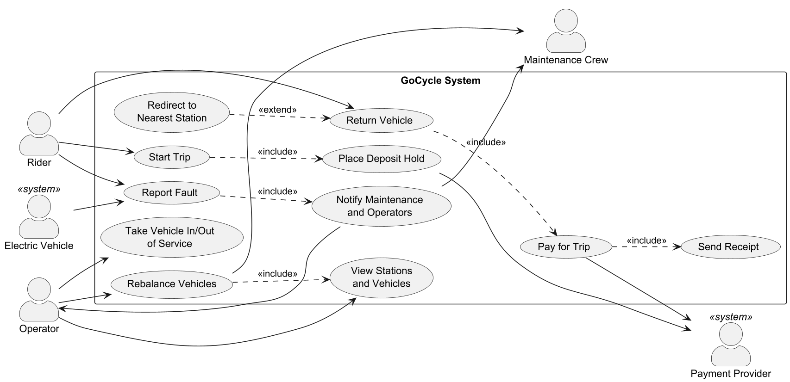
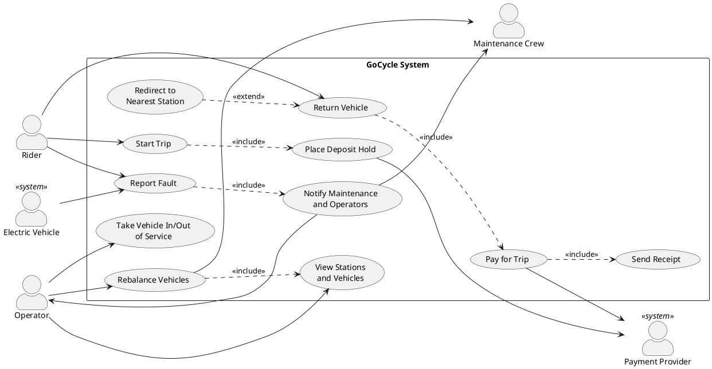

# GoCycle Use Case Model

This document describes who uses GoCycle and the main ways they use it. Requirement IDs (FR, QR, C) refer to [requirements.md](requirements.md).

## Actors

| Actor | Kind | Description |
|-------|------|-------------|
| Rider | Primary, human | A casual rider, member or student who rents vehicles through the phone app or a station screen. |
| Operator | Primary, human | Control-room staff who monitor all stations and vehicles, rebalance vehicles and take vehicles in or out of service. |
| Maintenance Crew | Secondary, human | Field staff who are notified of faults, repair vehicles and physically move vehicles during rebalancing. |
| Electric Vehicle | Primary, system | An e-bike or e-scooter that reports its own low battery and faults to GoCycle. |
| Payment Provider | Secondary, system | The external service behind credit cards, city transit cards and phone wallets; it places holds and processes charges. |

## Use case diagram

The diagram shows these relationships:

- **Start Trip** always includes **Place Deposit Hold**.
- **Return Vehicle** always includes **Pay for Trip**, which always includes **Send Receipt**.
- **Report Fault** always includes **Notify Maintenance and Operators**, whether the rider or the electric vehicle raises the report.
- **Redirect to Nearest Station** extends **Return Vehicle** only when the station has no free docking point.

## UC-01 Start Trip

| | |
|-|-|
| **ID** | UC-01 |
| **Primary actor** | Rider |
| **Secondary actors** | Payment Provider |
| **Stakeholders and interests** | **Rider:** wants to unlock a working vehicle quickly and be charged fairly. **GoCycle:** wants only safe, charged vehicles rented and a deposit secured before the vehicle leaves. **Payment Provider:** wants a valid hold request on an accepted method. |
| **Preconditions** | The rider has an account with a rider type (casual, member or student) and at least one payment method. The rider is at a station with at least one docked vehicle. |

**Main success scenario**

1. The rider identifies themselves through the phone app or by tapping their card on the station's card reader.
2. The rider selects a docked vehicle.
3. The system checks that the vehicle is rentable: it is in service, and if it is electric, its battery is at least 20%.
4. The rider chooses a payment method.
5. The system checks that the payment method is allowed in the station's zone.
6. The system places a refundable $50.00 deposit hold through the Payment Provider (include **Place Deposit Hold**).
7. The system unlocks the vehicle, marks it in use and records the start time.
8. The rider takes the vehicle, and the trip is active.

**Alternate flows**

- **1a. The card reader cannot read the rider's card:**
  1. The station screen asks the rider to tap again or use the phone app.
  2. The use case resumes at step 1.
- **3a. The electric vehicle's battery is below 20%:**
  1. The system tells the rider the vehicle cannot be rented because its battery is low, and shows other vehicles at the station.
  2. If the rider picks another vehicle, the use case resumes at step 2. Otherwise it ends and no trip starts.
- **3b. The vehicle is out of service:**
  1. The system tells the rider the vehicle is unavailable.
  2. The use case continues as in 3a.
- **5a. The payment method is not allowed in this zone:**
  1. The system tells the rider the method is not accepted here and lists the methods this zone allows.
  2. If the rider chooses an allowed method, the use case resumes at step 5. Otherwise it ends and no trip starts.
- **6a. The Payment Provider declines the deposit hold:**
  1. The system tells the rider the hold was declined. The vehicle stays locked.
  2. If the rider chooses another method, the use case resumes at step 4. Otherwise it ends and no trip starts.
- **7a. The vehicle fails to unlock:**
  1. The system releases the deposit hold and leaves the trip not started.
  2. The rider is invited to report a fault (UC-03) and choose another vehicle.

**Postconditions**

- **Success:** a trip is active for the rider, the deposit hold is placed, the vehicle is marked in use and the start time is recorded.
- **Failure:** no trip exists, no hold remains on the rider's payment method and the vehicle stays docked.

**Related requirements:** FR-01, FR-02, FR-08, FR-11, FR-12, FR-22, FR-23, FR-24, FR-25, C-01, C-03, QR-04

## UC-02 Return Vehicle

| | |
|-|-|
| **ID** | UC-02 |
| **Primary actor** | Rider |
| **Secondary actors** | Payment Provider |
| **Stakeholders and interests** | **Rider:** wants to be able to return anywhere convenient and to stop paying as soon as the vehicle is docked. **GoCycle:** wants every vehicle securely locked before a trip ends, so vehicles are not lost. **Operators:** want accurate station occupancy. |
| **Preconditions** | The rider has an active trip (UC-01). |

**Main success scenario**

1. The rider arrives at a station.
2. The system shows that the station has a free docking point.
3. The rider pushes the vehicle into the free docking point.
4. The docking point confirms the vehicle is locked.
5. The system records the end time and ends the trip; charging stops at this moment.
6. The system takes payment (include **Pay for Trip**, UC-04).
7. The system marks the vehicle available at this station.

**Alternate flows**

- **2a. The station has no free docking point (extend Redirect to Nearest Station):**
  1. The system finds the nearest station with at least one free docking point and directs the rider there on the station screen or in the app.
  2. The trip stays active and charging continues.
  3. The use case resumes at step 1 at the new station.
- **4a. The docking point does not confirm the lock:**
  1. The system tells the rider the vehicle is not locked and asks them to re-seat it.
  2. The trip stays active and charging continues.
  3. The use case resumes at step 3.
  4. If the lock still fails, the rider may report a fault on the docking point or vehicle (UC-03) and use another free point.
- **6a. Payment fails:** see UC-04, alternate flows 3a and 3b.

**Postconditions**

- **Success:** the vehicle is locked in a docking point and marked available, the trip has ended with its end time equal to the lock-confirmation time, and the rider has paid and received a receipt.
- **While not locked:** the trip remains active and charging continues.

**Related requirements:** FR-13, FR-14, FR-15, FR-16, FR-17, FR-09, FR-30, QR-03, C-02
